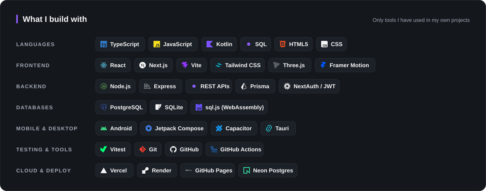
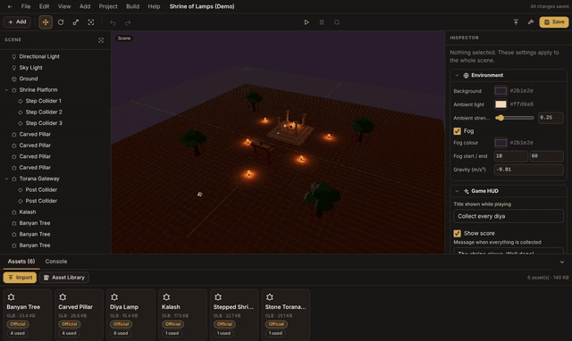
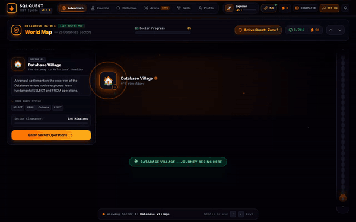

  
  

  
  
  

### `> whoami`

Computer Engineering student at SSBT COET, Jalgaon (class of 2029) and Vice President of **SSBT Ignite E-Cell**. I build full-stack products end to end, from UI and APIs to databases, auth and deployment. Currently open to **internships**.

### `> ls ./projects`

<table>
<tr>
<td width="50%"></td>
<td width="50%"></td>
</tr>
<tr>
<td><b><a href="https://github.com/piyushmali61/mythic-forge">Mythic Forge</a></b>: offline-first 3D creation and game engine for web, Android and Windows. 165 tests in CI. <code>TypeScript</code> <code>Three.js</code> <code>Tauri</code></td>
<td><b><a href="https://piyushmali61.github.io/sql-quest-dataverse/">SQL Quest</a></b>: learn SQL by playing, with real SQLite running in the browser via WebAssembly. 26 sectors, 204 missions. <code>React</code> <code>sql.js</code> <code>Vite</code></td>
</tr>
</table>

| Project | What it does | Stack |
| --- | --- | --- |
| [AstraRide](https://github.com/piyushmali61/bike-ride-project) | Android convoy intercom with an offline Bluetooth LE mesh chat (beta, co-built with Aayush Jivan Chaudhari) | Kotlin · Compose · Nearby |
| [IPL Auction](https://github.com/piyushmali61/ipl-auction) | Live auction dashboard with Excel import and Google Sheets sync | JS · Apps Script |
| [SSBT Portal](https://piyushmali61.github.io/FIRST-DEMO-THEMEE-PROJECET/) | Mobile-first student portal with 10 themes (demo data) | HTML · CSS · JS |
| [SSBT Ignite Platform](https://ssbt-ignite-portfolio.vercel.app/) | Official E-Cell platform with an admin panel (sole developer) | Next.js · Prisma · Postgres |
| [HEC Event Site](https://hec.ssbt-ignite.in/) | Harry Potter–themed event portal with Google sign-in (co-built) | React · Express · SQLite |

### `> git log --stats`

  
  
  <picture>
    <source media="(prefers-color-scheme: light)" srcset="https://raw.githubusercontent.com/piyushmali61/piyushmali61/output/snake-light.svg" />
    
  </picture>

